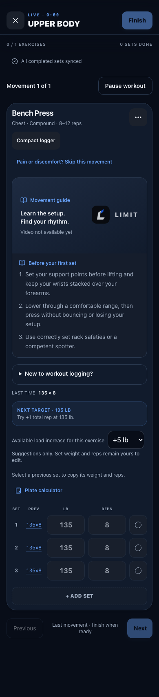
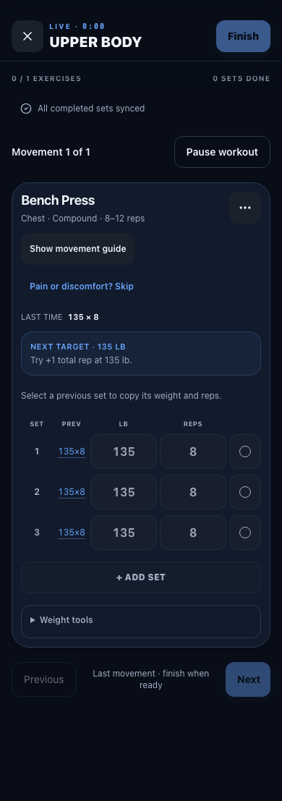
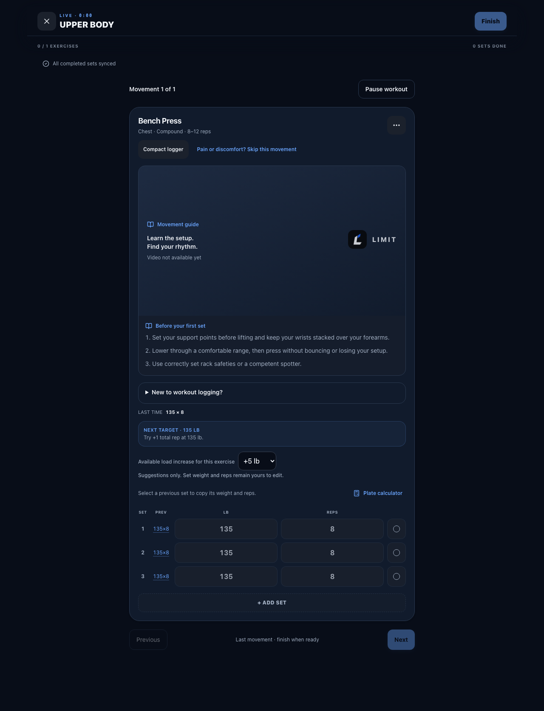
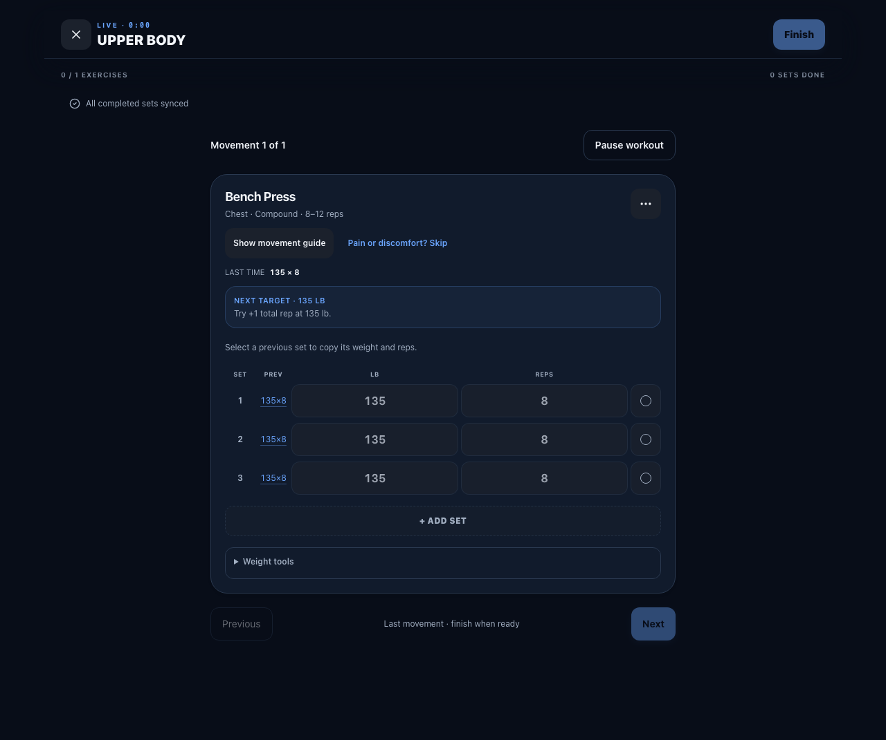

# Workout and meal recovery follow-up

## Corrected behavior

- Native workout edits are locked while sets are syncing and throughout Finish. A synchronous guard also rejects queued change events. Finish rechecks pending rows and keeps the draft on failure; a response from an old account/navigation scope cannot remove the current draft. The delayed-save component regression fails against the prior workout screen and passes with this change.
- Load-step preferences use a validated `setLoadIncrement` command. The account coordinator reads the current owned profile and updates one catalog exercise, preserving other keys across clients and lost-response retries. The client no longer submits a stale whole map. Local Worker/D1 checks cover concurrent changes, retry, invalid values, unknown exercises and two-account isolation.
- Meal shortcuts validate the complete food payload before recording an uncertain write. Invalid portions remain editable. For an invalid marker left by an older client, retry first looks up its owner-scoped operation ID: a saved meal is acknowledged, an absent one is released for correction, and a failed lookup preserves the marker. Valid uncertain writes retain their original portions and operation ID.
- Invalid workout command values return HTTP 400 instead of being mislabeled as a server failure.

## Workout layout

Returning movements open in compact mode; first-time users see setup guidance and can choose **Ready to log sets**, which focuses the first weight field. The guide choice is remembered per profile/exercise and cleared with private logout state. Optional load-increment and plate controls sit below the logger in **Weight tools**. Set-type buttons are 44 pixels wide, complete/uncheck labels include the set number, and extra-set removal has a full touch target.

The same disposable fixture was captured at 390 and 1280 pixels. These images exercise the written media fallback, not live media availability:

| Before | After |
| --- | --- |
|  |  |
|  |  |

Focused browser checks passed at 320, 390, 430, 820 and 1280 pixels, including light/dark logging, copy-previous, plate calculations, guide persistence, focus and touch-target sizing. Full-suite and hosted results must be recorded separately.

## Supported clients and remaining acceptance

The current web build and matching Expo source understand shortened-session budgets. Older clients' normal workout payloads remain accepted. Older installed builds that do not understand a saved shortened session cannot safely record excluded exercises; the API rejects those writes with an upgrade/web recovery message. This is an explicit compatibility limit, not proof of seamless old-client recovery.

Keep the old device's local storage until upgrading. The current Expo client retains excluded unsynced rows and requires explicit discard before finishing the shortened session. Do not tell users that switching to the web transfers unsynced native rows: it does not. A real prior-binary upgrade/recovery acceptance run is still required before distributing a native release.

The local Mac has Xcode 26.2. Expo SDK 57's current documentation requires Xcode 26.4 or newer. JavaScript exports and component tests do not establish native compilation, simulator launch, physical-device behavior or TestFlight acceptance. No paid build or toolchain upgrade was initiated by this follow-up.

Local regression evidence after the layout/privacy follow-up: 545 unit tests across 70 files and 17 API assertions/tests including the parent lifecycle test. Logout also removes the departing account's private pending meal payloads. The first PR run caught an active-scope ref assignment during render; that guard now updates/cleans up in a layout effect, and uncached mobile lint/types and a clean-install native regression pass. Final exact-head CI and hosted acceptance remain required before release.

## Final readability and recovery-state review

Compact mode removes the redundant previous-session summary and copying instruction; each set retains its own one-tap previous values. Column labels are 12px at default text size. The logger reflows into labeled two-row sets when enlarged text leaves insufficient room, preserving full weight/repetition values. Rest and retry controls have 44px minimum height. The last exercise offers Finish directly.

Twenty-five focused browser checks cover all five widths, both themes, first-use focus, pending save, failed save/retry using the same operation ID, completed/rest state, long names, large values, default and enlarged text and reduced viewport height. The initial screenshots exposed clipped values and overlapping navigation despite no page overflow; the corrected run adds text-width and button-overlap assertions. The 320px/default-text large-value width check also passes before reflow. Rest-state captures wait for the finite panel animation to settle. Reduced viewport height is browser evidence, not a physical keyboard/device test.

- [Compact phone](evidence/workout-compact-final-390.png) and [desktop](evidence/workout-compact-final-1280.png).
- [Failed save with retained values](evidence/workout-retry-final-320.png) and [saved/rest state](evidence/workout-rest-final-320.png).
- [Enlarged text and large values at 320px](evidence/workout-large-text-final-320.png).

These use disposable mocked fixtures and written media fallback. They do not establish live media or native device acceptance. Final CI and exact-version hosted acceptance are recorded in the release PR.
